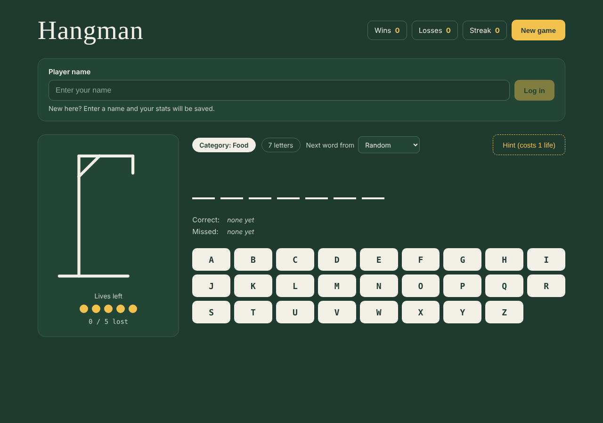
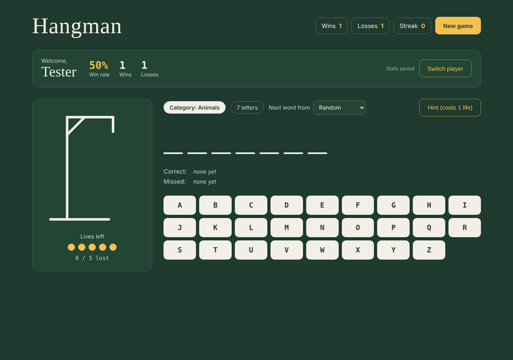
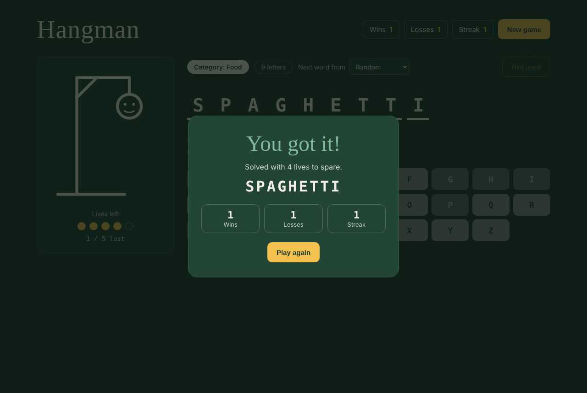

# Hangman

A browser Hangman game built with React and Vite, with player accounts saved in
DynamoDB. Log in with your name, guess the hidden word one letter at a time
before the hangman is finished (you have **5 lives**), and your wins, losses and
winning percentage are saved between visits.

## Description

The game picks a random word from one of four categories (Programming, Animals,
Atlanta, Food) and shows it as blanks. Pick letters from the on-screen keyboard
or type them on your physical keyboard. Correct letters fill in the blanks;
each wrong letter costs a life and adds a body part to the hangman. Fill in the
whole word to win, or lose all 5 lives and the game reveals the word.

**Version 2 adds players.** Enter your name to log in. If you're new, you're
added to the database; if you've played before, your record is loaded. Your
name and winning percentage show on the home screen, and every finished game
updates your saved stats.

The project has three parts, all started together with Docker Compose:

| Part | Folder | What it is | Port |
|---|---|---|---|
| Game (frontend) | `/` (`src/`) | React + Vite | 3000 |
| API (backend) | `server/` | Node.js + Express + AWS SDK v3 | 4000 |
| Database | `docker/dynamodb/` (data) | DynamoDB Local (Amazon's Docker image) | 8000 |

```
Browser (React) ──fetch──▶ Express API ──AWS SDK──▶ DynamoDB Local
   :3000                      :4000                    :8000
```

### Features

| Requirement | How it's done |
|---|---|
| Track the current player, with a `playerID` primary key | Each player gets a random UUID as `playerID` (the table's partition key), so two players named "Mike" never collide |
| Track the player's wins and losses | `wins` and `losses` are saved on the player's item in DynamoDB |
| Show the winning percentage and player name | `PlayerStats` shows the name, win rate, wins and losses |
| Check if the player exists with a GET (query, not scan) | `GET /players?playerName=` uses a **Query** on the `PlayerNameIndex` global secondary index |
| New player: handle the 404 and add them | The frontend treats a 404 as "new player" and sends a `POST /players` |
| Existing player: log them in and remove the login button | `isLoggedIn` (a boolean in state) swaps `LoginForm` for `PlayerStats` |
| Update stats when the game is over | `scoreUpdate()` updates the player in React state first, then `componentDidUpdate()` sends `PUT /players/:playerID` |
| Use fetch with async/await | All calls are in `src/api/players.js` |

Game features from version 1: the hangman picture (6 images for 5 lives),
on-screen and physical keyboard, used keys greyed out with a red X on misses,
correct/missed letter lists, New game button, win/lose pop-up, a hint (costs 1
life), a category picker and a streak counter.

Names are matched without caring about capital letters, so "Brock" and "brock"
log into the same player. Games played before logging in count as guest games
and are not saved.

## Visuals

**Logging in:**



**Logged in, with name and winning percentage:**



**Win and loss pop-ups:**




**The six hangman pictures (0 to 5 wrong guesses):**


## Installation

### With Docker Compose (recommended)

Requirements: [Docker Desktop](https://www.docker.com/products/docker-desktop/),
open and showing **Engine running**.

```bash
git clone https://github.com/BJCJ27/hangman.git
cd hangman
docker compose up --build
```

This starts three containers:

1. **`hangman-dynamodb`**: DynamoDB Local on port 8000. Data is saved in the
   `docker/dynamodb/` folder, so players are kept when you restart.
2. **`hangman-api`**: the Express API on port 4000. On start it waits for
   DynamoDB and creates the `Players` table if it doesn't exist. You'll see
   `Hangman API running on http://localhost:4000` in the logs.
3. **`hangman-app`**: the game on port 3000.

Open **http://localhost:3000** and log in with any name.

To stop: press <kbd>Ctrl</kbd>+<kbd>C</kbd>, then run `docker compose down`.
To also delete all saved players, delete the `docker/dynamodb` folder.

> **"failed to connect to the docker API"** means Docker Desktop isn't running.
> **"Virtualization support not detected"** means CPU virtualization (SVM on
> AMD, VT-x on Intel) is turned off in the BIOS.

### Without Docker

Requirements: [Node.js](https://nodejs.org/) **20.19 or newer**, plus a
DynamoDB Local running on port 8000. You can start just the database with
`docker compose up dynamodb`.

```bash
# Terminal 1: the API
cd server
npm install
npm run dev          # http://localhost:4000

# Terminal 2: the game
npm install
npm run dev          # http://localhost:5173
```

## Usage

1. Type your name in **Player name** and click **Log in** (or press
   <kbd>Enter</kbd>).
   - **New player:** you're created with 0 wins / 0 losses and see
     "Welcome, [name]".
   - **Returning player:** your saved stats load and you see
     "Welcome back, [name]".
   - Either way, the login box is replaced by your name, win rate, wins and
     losses.
2. Play: click or type letters. Used keys turn grey; misses also get a red X.
3. When a game ends, your stats update on screen right away and are saved to
   the database. "Stats saved" confirms it.
4. **Switch player** logs out so someone else can log in.

## API

Base URL: `http://localhost:4000`. All bodies are JSON.

| Method | Endpoint | Body | Responses |
|---|---|---|---|
| `GET` | `/players?playerName=Brock` | none | `200` player · `404` not found (new player) · `400` missing or invalid name |
| `POST` | `/players` | `{ "playerName": "Brock" }` | `201` new player · `409` already exists (includes `player`) · `400` invalid name |
| `PUT` | `/players/:playerID` | `{ "wins": 3, "losses": 1 }` | `200` updated player · `404` unknown `playerID` · `400` wins/losses not whole numbers ≥ 0 |
| `GET` | `/health` | none | `200 { "status": "ok" }` |

A player looks like this:

```json
{
  "playerID": "0e8c5593-9453-4b92-ae95-05443c6abbaa",
  "playerName": "Brock",
  "playerNameLower": "brock",
  "wins": 3,
  "losses": 1,
  "createdAt": "2026-11-17T23:02:54.643Z",
  "updatedAt": "2026-11-17T23:10:12.008Z"
}
```

### DynamoDB table

- **Table:** `Players`, with partition key `playerID` (string).
- **Global secondary index:** `PlayerNameIndex`, with partition key
  `playerNameLower`. This lets the GET look a player up by name with a
  **Query**, which reads only the matching item, instead of a **Scan**, which
  reads every player in the table.
- **Billing:** on-demand (`PAY_PER_REQUEST`).

### Trying the API in Postman

Import `server/hangman-api.postman_collection.json` into the
[Postman app](https://www.postman.com/downloads/). Run the requests in order
(1 → 4). The POST saves the new `playerID` into a collection variable, so the
PUT uses it automatically. Change the `playerName` variable to try other
players.

## Testing

Both parts have unit tests written with [Vitest](https://vitest.dev/).

```bash
# Frontend (from the project root): player name + stats UI and the login flow
npm install
npm test

# API (from server/): routes and DynamoDB commands
cd server
npm install
npm test
```

Or, with the containers running (`docker compose up`), run them inside Docker:

```bash
docker compose exec app npm test
docker compose exec api npm test
```

No database or running server is needed for the tests:

- **UI tests** (`src/test/`, React Testing Library + jsdom). `fetch` is faked,
  so they check what the app sends and shows:
  - `PlayerStats.test.jsx`: shows the player name, win percentage (75%, 0% for
    new players), wins/losses, and the welcome messages.
  - `LoginForm.test.jsx`: the button stays disabled until a name is typed,
    names are trimmed, Enter submits, and error and loading states show.
  - `App.player.test.jsx`: a GET logs in an existing player and removes the
    login button; a 404 leads to a POST; the server being down shows an error;
    a win or loss updates stats on screen and then sends a PUT with the new
    totals; typing a name doesn't guess letters; guest games don't call the API.
  - `stats.test.js`: the winning-percentage math.
- **API tests** (`server/test/`):
  - `app.test.js` uses supertest to send real HTTP requests to the Express app,
    with an in-memory fake database. It covers every status code in the table
    above, plus CORS and a database failure (500).
  - `players.test.js` uses aws-sdk-client-mock to check the exact DynamoDB
    commands: a Query (never a Scan) on `PlayerNameIndex`, unique `playerID`s,
    the update by `playerID`, and the "player doesn't exist" case.

`npm run lint` checks the code with oxlint.

## Project structure

```
hangman/
├── docker-compose.yml             # dynamodb + api + app
├── Dockerfile                     # the React app
├── src/                           # FRONTEND
│   ├── App.jsx                    # Parent: game state, player state, login + save logic
│   ├── api/
│   │   └── players.js             # fetch + async/await calls: getPlayer, createPlayer, updatePlayerStats
│   ├── components/
│   │   ├── LoginForm.jsx          # Name input + Log in button (controlled input)
│   │   ├── PlayerStats.jsx        # Player name, win %, wins, losses, Switch player
│   │   ├── Header.jsx             # Title, score, New game button
│   │   ├── HangmanDrawing.jsx     # Current hangman picture + lives left
│   │   ├── WordDisplay.jsx        # The word as blanks / letters
│   │   ├── GuessedLetters.jsx     # Correct and missed letters
│   │   ├── Keyboard.jsx           # A–Z keyboard, maps letters to LetterButtons
│   │   ├── LetterButton.jsx       # One letter key
│   │   └── GameOverModal.jsx      # Win / lose pop-up
│   ├── utils/stats.js             # winPercentage()
│   ├── data/                      # Word bank + the 6 hangman pictures
│   └── test/                      # UI unit tests
├── server/                        # BACKEND
│   ├── Dockerfile                 # the API
│   ├── src/
│   │   ├── server.js              # Entry point: create table, start Express on :4000
│   │   ├── app.js                 # Express app: cors, JSON, the GET / POST / PUT routes
│   │   ├── players.js             # DynamoDB calls: Query, Put, Update
│   │   ├── db.js                  # DynamoDB client (points at DynamoDB Local)
│   │   └── createTable.js         # Creates the Players table + PlayerNameIndex
│   ├── test/                      # API unit tests
│   └── hangman-api.postman_collection.json
├── scripts/generate_stages.py     # Draws the hangman SVGs
├── docs/                          # README screenshots
└── AI_CONTRIBUTION.md
```

### Server files

- **`server.js`**: runs `ensureTable()`, then starts the Express app on `PORT`
  (default 4000).
- **`app.js`**: `createApp(players)` builds the Express app. It turns on `cors()`
  so the React app (a different port) is allowed to call it, turns on
  `express.json()` to read request bodies, and sets up the routes. It checks
  every input before touching the database and sends errors to one error
  handler that returns `500`. The database functions are passed in as an
  argument, so tests can swap in a fake.
- **`players.js`**: the only file that talks to DynamoDB, using the Document
  Client from `@aws-sdk/lib-dynamodb`:
  - `findPlayerByName`: a `QueryCommand` on `PlayerNameIndex`.
  - `createPlayer`: a `PutCommand` with a new `randomUUID()`.
  - `updatePlayerStats`: an `UpdateCommand` with
    `ConditionExpression: attribute_exists(playerID)`, so it returns 404
    instead of quietly creating a new player.
- **`db.js`**: creates the `DynamoDBClient` from environment variables
  (`DYNAMODB_ENDPOINT`, `AWS_REGION`, `AWS_ACCESS_KEY_ID`,
  `AWS_SECRET_ACCESS_KEY`, `TABLE_NAME`). In Docker the endpoint is
  `http://dynamodb:8000`, the database container's name on the Compose network.
- **`createTable.js`**: the table definition, and `ensureTable()`, which retries
  for up to 30 seconds while DynamoDB Local starts up. Run it on its own with
  `npm run create-table`.

## Support

Open an issue on the GitHub repository, or contact the author through GitHub
([@BJCJ27](https://github.com/BJCJ27)).

## Roadmap

- Leaderboard: top players by win percentage (`GET /players/top`)
- Remember the logged-in player after a page refresh
- Passwords or PINs, so nobody can log in as someone else
- Two-player mode where one player types the secret word

## Contributing

This is a class project, but suggestions are welcome. Fork the repo, create a
branch, and open a pull request. Run `npm test` in both the root and `server/`,
plus `npm run lint`, before submitting.

## Authors and acknowledgment

- **Brock Caston Jr.** — [@BJCJ27](https://github.com/BJCJ27)
- Built with help from Claude (Anthropic) — see
  [AI_CONTRIBUTION.md](AI_CONTRIBUTION.md).
- DynamoDB in Docker based on
  [Running DynamoDB locally using Docker](https://medium.com/@bthiban/running-dynamodb-locally-using-docker-68c8bbed29fa).
- DynamoDB calls follow the
  [AWS SDK for JavaScript v3 examples](https://docs.aws.amazon.com/amazondynamodb/latest/developerguide/getting-started-step-2.html).
- Project scaffolded with [Vite](https://vite.dev/guide/)'s React template.

## Technologies used

- [React 19](https://react.dev/) (class components) and [Vite 8](https://vite.dev/)
- [Express 5](https://expressjs.com/), [cors](https://www.npmjs.com/package/cors)
- [AWS SDK for JavaScript v3](https://docs.aws.amazon.com/AWSJavaScriptSDK/v3/latest/)
  (`@aws-sdk/client-dynamodb`, `@aws-sdk/lib-dynamodb`)
- [DynamoDB Local](https://hub.docker.com/r/amazon/dynamodb-local) in Docker
- [Vitest](https://vitest.dev/), [React Testing Library](https://testing-library.com/docs/react-testing-library/intro/),
  [supertest](https://www.npmjs.com/package/supertest),
  [aws-sdk-client-mock](https://www.npmjs.com/package/aws-sdk-client-mock)
- Docker / Docker Compose, Postman

## License

[MIT](https://choosealicense.com/licenses/mit/)

## Project status

Version 2 (players + DynamoDB) is complete for the assignment. Roadmap items
may be added later.
