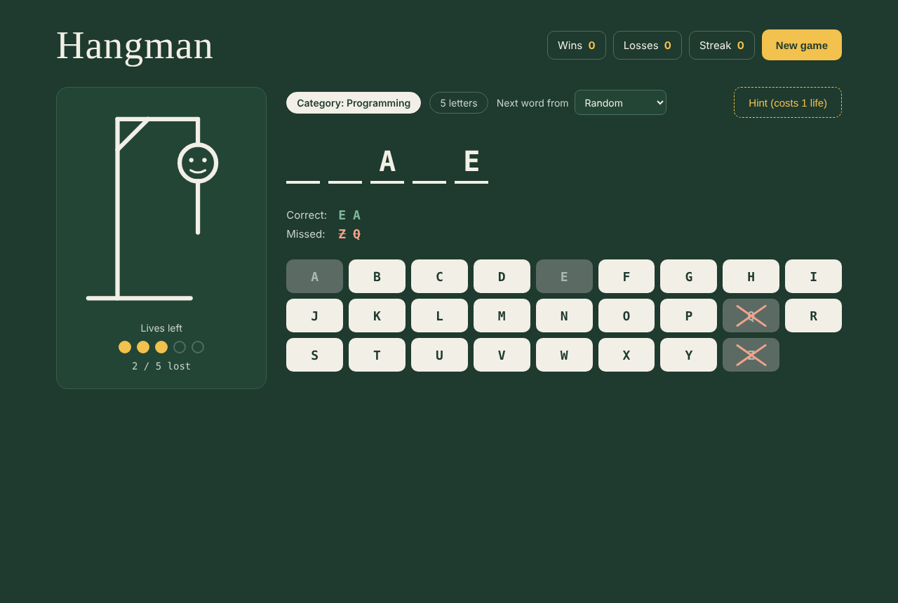
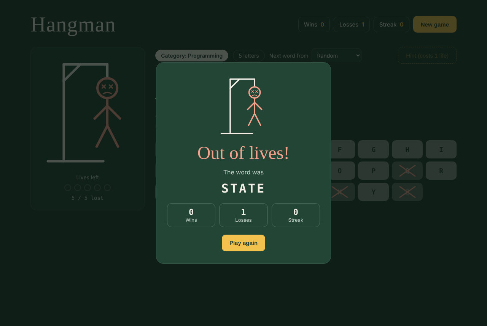
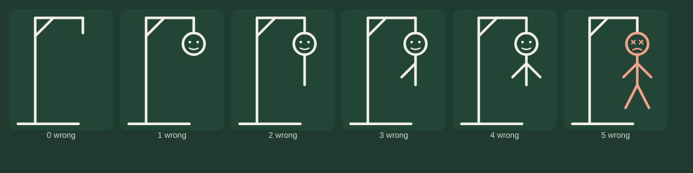

# Hangman

A browser Hangman game built with React and Vite. Guess the hidden word one
letter at a time before the hangman is finished — you have **5 lives**.

## Description

The game picks a random word from one of four categories (Programming, Animals,
Atlanta, Food) and shows it as blanks. Pick letters from the on-screen keyboard
or type them on your physical keyboard. Correct letters fill in the blanks;
each wrong letter costs a life and adds a body part to the hangman. Fill in the
whole word to win, or lose all 5 lives and the game reveals the word.

This project was built for the Fullstack class assignment on **React
components** and shows:

- **Multiple components** — the UI is split into 8 class components (see
  [Project structure](#project-structure)).
- **State** — the parent `App` owns all game state (word, guessed letters, hint,
  score).
- **Props** — children only display the props they are given.
- **Events / callbacks** — buttons call methods passed down from `App`
  (`onGuess`, `onNewGame`).
- **Lists and keys** — the keyboard, word blanks and guessed letters are built
  with `.map()`.
- **Conditional rendering** — the win/lose pop-up only renders when the game is
  over.
- **Lifecycle methods** — `componentDidMount` / `componentWillUnmount` add and
  remove the physical-keyboard listener.

### Features

| Requirement | How the game does it |
|---|---|
| Show the current hangman (6 pictures for 5 lives) | `HangmanDrawing` shows `stage-0.svg` – `stage-5.svg` based on lives lost |
| Let the user select a letter | `Keyboard` → 26 `LetterButton`s, plus typing on a physical keyboard |
| Show the user's chosen letters | Used keys turn grey, misses get a red X; `GuessedLetters` also lists correct and missed letters |
| New game button | In the header, and **Play again** in the pop-up (or press <kbd>Enter</kbd>) |
| Pop-up showing win or loss | `GameOverModal` |

Extras from the paper prototype: word category, lives-left dots, a **hint**
button that reveals one letter for the cost of one life (once per game), a
category picker for the next word, and a wins / losses / streak score.

## Visuals

**Playing:**



**Win and loss pop-ups:**




**The six hangman pictures (0 to 5 wrong guesses):**



## Installation

### With Docker (recommended)

Requirements: [Docker Desktop](https://www.docker.com/products/docker-desktop/).

```bash
git clone https://github.com/BJCJ27/hangman.git
cd hangman
docker compose up --build
```

Open **http://localhost:3000**. Stop it with <kbd>Ctrl</kbd>+<kbd>C</kbd>, then
`docker compose down`.

### Without Docker

Requirements: [Node.js](https://nodejs.org/) **20.19 or newer** (Vite 8 does
not run on Node 18) and npm.

```bash
git clone https://github.com/BJCJ27/hangman.git
cd hangman
npm install
npm run dev
```

Open the URL Vite prints (usually **http://localhost:5173**).

### Other commands

```bash
npm run build     # production build into dist/
npm run preview   # serve the production build
npm run lint      # run the linter (oxlint)
```

## Usage

1. A new word loads automatically. The category and letter count are shown
   above the blanks.
2. Click a letter, or type it. Every letter you use turns **grey**, and letters
   that aren't in the word also get a **red X**. Used keys are disabled so you
   can't guess the same letter twice.
3. Stuck? Click **Hint (costs 1 life)** to reveal one letter. You get one hint
   per game, and it's disabled when you only have one life left.
4. Use **Next word from** to pick a category for the next word (or Random).
5. When the game ends, a pop-up says whether you won or lost and shows the
   word. Click **Play again** or press <kbd>Enter</kbd>.
6. **New game** in the header skips the current word at any time. Your score
   is kept until you reload the page.

### Adding words

Edit `src/data/words.js`. Words must be uppercase letters only (no spaces or
punctuation). Add a new key to `WORD_BANK` to create a new category.

### Changing the hangman pictures

The pictures are SVG files in `src/assets/stages/`, generated by
`scripts/generate_stages.py`. Edit the script and run
`python3 scripts/generate_stages.py`, or swap in your own images with the same
file names.

## Project structure

```
hangman/
├── src/
│   ├── App.jsx                    # Parent: game state + guessLetter / giveHint / newGame
│   ├── components/
│   │   ├── Header.jsx             # Title, score, New game button
│   │   ├── HangmanDrawing.jsx     # Current hangman picture + lives left
│   │   ├── WordDisplay.jsx        # The word as blanks / letters
│   │   ├── GuessedLetters.jsx     # Correct and missed letters
│   │   ├── Keyboard.jsx           # A–Z keyboard, maps letters to LetterButtons
│   │   ├── LetterButton.jsx       # One letter key
│   │   └── GameOverModal.jsx      # Win / lose pop-up
│   ├── data/
│   │   ├── words.js               # Word bank by category + random picker
│   │   └── stages.js              # Imports the 6 hangman pictures
│   ├── assets/stages/             # stage-0.svg … stage-5.svg
│   ├── App.css                    # Game styles
│   └── index.css                  # Colors, fonts, page base
├── scripts/generate_stages.py     # Draws the hangman SVGs
├── docs/                          # README screenshots
├── Dockerfile
├── docker-compose.yml
└── AI_CONTRIBUTION.md
```

## Support

Open an issue on the GitHub repository, or contact the author through GitHub
([@BJCJ27](https://github.com/BJCJ27)).

## Roadmap

- Two-player mode where one player types the secret word
- Difficulty levels (word length / number of lives)
- Save the score in `localStorage` so it survives a reload
- Sound effects for hits and misses
- Backend word API and leaderboard

## Contributing

This is a class project, but suggestions are welcome. Fork the repo, create a
branch, and open a pull request. Run `npm run lint` and `npm run build` before
submitting.

## Authors and acknowledgment

- **Brock Caston Jr.** — [@BJCJ27](https://github.com/BJCJ27)
- Built with help from Claude (Anthropic) — see
  [AI_CONTRIBUTION.md](AI_CONTRIBUTION.md).
- Project scaffolded with [Vite](https://vite.dev/guide/)'s React template.
- Fonts: [Gochi Hand](https://fonts.google.com/specimen/Gochi+Hand) and
  [IBM Plex](https://fonts.google.com/specimen/IBM+Plex+Sans) from Google Fonts.

## Technologies used

- [React 19](https://react.dev/) (class components)
- [Vite 8](https://vite.dev/)
- [Docker](https://www.docker.com/) / Docker Compose
- Plain CSS, SVG images

## License

[MIT](https://choosealicense.com/licenses/mit/)

## Project status

Complete for the assignment. Features on the roadmap may be added later.
